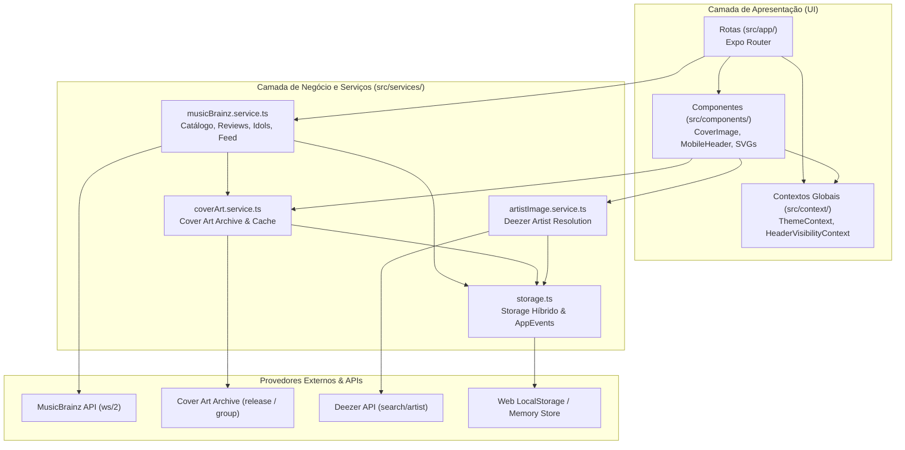

# 🏛️ Arquitetura do Sistema — Musicpostr Mobile

Este documento descreve os princípios arquiteturais, a estrutura modular de diretórios e o fluxo de dados do aplicativo **Musicpostr Mobile**.

---

## 🎯 Visão Geral Arquitetural

O projeto adota uma arquitetura em camadas focada em desacoplamento, portabilidade multiplataforma (iOS, Android e Web) e performance nativa.



---

## 📂 Estrutura de Pastas

```text
musicpostr-mobile/
├── assets/                     # Recursos visuais (ícones, logos, splash screen)
├── doc/                        # Documentação técnica detalhada
├── docs/                       # Diretório auxiliar / padrões de contribuição
├── scripts/                    # Scripts utilitários de manutenção
├── src/
│   ├── app/                    # Telas e rotas baseadas em arquivos (Expo Router)
│   │   ├── (tabs)/             # Abas principais da navegação inferior
│   │   ├── album/[id].tsx      # Rota dinâmica: Detalhes do Álbum
│   │   ├── artist/[id].tsx     # Rota dinâmica: Detalhes do Artista
│   │   ├── list/[id].tsx       # Rota dinâmica: Detalhes da Lista de Álbuns
│   │   ├── user/[username].tsx # Rota dinâmica: Perfil de Outro Usuário
│   │   ├── favorites.tsx       # Tela: Álbuns Favoritos
│   │   ├── friends.tsx         # Tela: Amigos da Comunidade
│   │   ├── idols.tsx           # Tela: Artistas Seguidos (Ídolos)
│   │   ├── lists.tsx           # Tela: Minhas Listas
│   │   ├── login.tsx           # Modal: Login e Cadastro
│   │   ├── my-reviews.tsx      # Tela: Minhas Avaliações
│   │   ├── settings.tsx        # Tela: Configurações e Tema
│   │   ├── top-albuns.tsx      # Tela: Ranking Completo de Álbuns
│   │   └── _layout.tsx         # Stack Navigator raiz e provedores globais
│   ├── components/             # Componentes visuais reutilizáveis
│   │   ├── ui/                 # Componentes genéricos de UI (collapsible, etc.)
│   │   ├── CoverImage.tsx      # Loader inteligente de capas com fallback em cascata
│   │   ├── MobileHeader.tsx    # Cabeçalho global com animação de visibilidade
│   │   ├── SocialIcon.tsx      # Ícones vetoriais de redes sociais (Instagram, X, etc.)
│   │   ├── StreamingIcon.tsx   # Ícones vetoriais de serviços de streaming (Spotify, etc.)
│   │   └── ...
│   ├── constants/              # Constantes de tema, espaçamento e fontes
│   ├── context/                # Contextos React (ThemeContext, HeaderVisibility)
│   ├── hooks/                  # Hooks customizados React (useColorScheme, useTheme)
│   ├── services/               # Camada de integração com APIs e persistência
│   │   ├── artistImage.service.ts
│   │   ├── coverArt.service.ts
│   │   ├── musicBrainz.service.ts
│   │   └── storage.ts
│   └── utils/                  # Utilitários (navegação segura, formatadores)
├── app.json                    # Metadados e manifesto Expo / EAS
├── eas.json                    # Perfis de compilação em nuvem (development, preview, production)
├── eslint.config.js            # Regras do ESLint Expo Flat Config
├── package.json                # Dependências e scripts do projeto
├── tailwind.config.js          # Configuração do NativeWind / Tailwind CSS
└── tsconfig.json               # Configuração estrita do TypeScript
```

---

## 🔄 Fluxo de Dados e Reatividade

1. **Estado Local e Componentes Funcionais**: Cada tela gerencia seu estado de visualização através de hooks nativos do React (`useState`, `useEffect`, `useMemo`).
2. **Barramento de Eventos (`AppEvents`)**: Para manter dados sincronizados entre telas independentes (ex.: ao avaliar um álbum na tela `album/[id]`, atualizar a lista de reviews em `my-reviews`, os números no `profile` e a timeline em `feed`), os serviços emitem eventos através de `AppEvents.emit(...)`.
3. **Assinatura Reativa**: As telas se inscrevem com funções utilitárias (`subscribeAlbumsUpdated`, etc.) e desinscrevem no cleanup do `useEffect`.
4. **Resolução em Cascata de Imagens**:
   - `CoverImage` verifica primeiramente cache local em memória.
   - Caso não exista, busca na API de destino (Deezer para foto do artista ou Cover Art Archive para capas de álbuns).
   - Se a capa não for encontrada ou a requisição falhar, cai automaticamente no pool de alta qualidade do Unsplash com hash determinístico, garantindo que o usuário nunca visualize áreas vazias ou quebradas.
