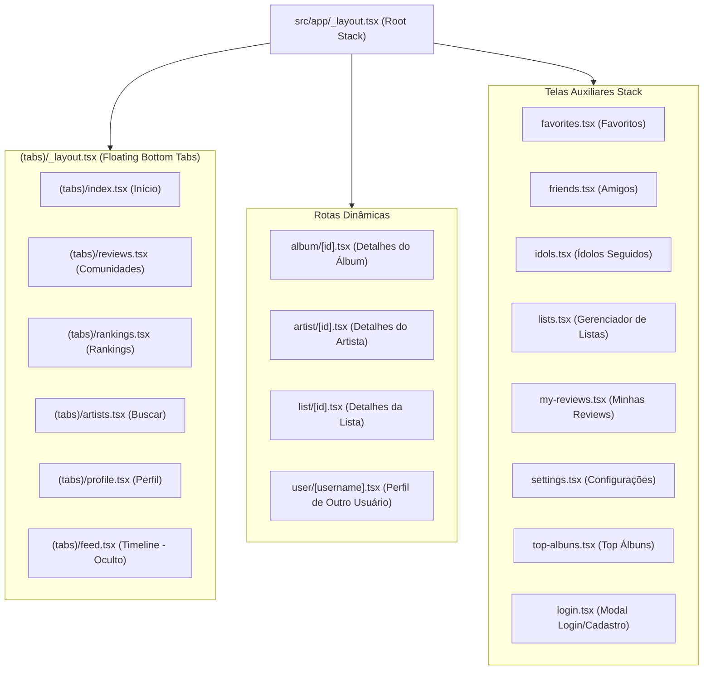

# 📱 Telas e Rotas — Musicpostr Mobile

O aplicativo utiliza o sistema de roteamento baseado em arquivos do **Expo Router**, localizado na pasta `src/app/`.

---

## 🗂️ Visão Geral das Rotas

---

## 📑 Detalhamento das Telas

### 1. Abas Inferiores (`src/app/(tabs)/`)

A barra de navegação flutuante (`FloatingTabsBar`) fornece acesso rápido às seções principais:

- **Início (`src/app/(tabs)/index.tsx`)**:
  - Hero card com o álbum em destaque do momento.
  - Carrosséis com "Mais Populares", "Novos Lançamentos" e "Top Músicas em Alta".
  - Acesso direto a rankings e discografias.
- **Comunidades & Catálogo (`src/app/(tabs)/reviews.tsx`)**:
  - Feed de álbuns e resenhas catalogadas com filtros interativos por gênero (*Rock, Pop, Hip-Hop, Indie, MPB, Eletrônica, R&B, Metal*).
  - Filtro por década / ano de lançamento e ordenação por nota ou popularidade.
- **Rankings & Pódio (`src/app/(tabs)/rankings.tsx`)**:
  - Pódio visual com os três primeiros colocados do Top Álbuns.
  - Tabela de classificação com posições, pontuações médias (1 a 10) e total de avaliações.
  - Filtros rápidos para refinar o ranking por estilo musical.
- **Buscar & Artistas (`src/app/(tabs)/artists.tsx`)**:
  - Campo de busca instantânea de artistas com fotos resolvidas via Deezer.
  - Botão de ação rápida para seguir/deixar de seguir o artista como **Ídolo**.
  - Lista de artistas em destaque e número de fãs.
- **Perfil do Usuário (`src/app/(tabs)/profile.tsx`)**:
  - Cabeçalho personalizável com avatar, imagem de capa (banner), nome e bio.
  - Estatísticas de engajamento: número de álbuns ouvidos, tempo estimado de audição, gênero favorito e média das notas atribuídas.
  - Atalhos diretos para Listas, Amigos, Ídolos, Reviews e Configurações.
  - Galeria de álbuns favoritados recentemente.
- **Feed da Comunidade (`src/app/(tabs)/feed.tsx`)**:
  - Timeline social exibindo em tempo real as atividades da comunidade (novas reviews, favoritos, listas criadas e ídolos seguidos).

---

### 2. Rotas Dinâmicas

- **Detalhes do Álbum (`src/app/album/[id].tsx`)**:
  - **Visualizador de Capas Frente e Verso**: Alternância animada entre a capa frontal e o verso do encarte em alta resolução via Cover Art Archive.
  - **Sistema de Avaliação 1-10 Estrelas**: Seleção interativa de notas com mensagens dinâmicas de reação de acordo com a pontuação dada.
  - **Resenha Escrita**: Campo para escrever resenhas detalhadas e publicar no feed.
  - **Tracklist Completa**: Listagem de todas as faixas do álbum com suas respectivas durações em minutos e segundos.
  - **Links de Streaming**: Botões com ícones oficiais de serviços (Spotify, Apple Music, YouTube Music, Deezer, etc.) que abrem links externos.
  - **Compartilhamento**: Suporte nativo para compartilhar a avaliação nos Stories do Instagram ou através da folha de compartilhamento do sistema operacional.
- **Detalhes do Artista (`src/app/artist/[id].tsx`)**:
  - Banner com a foto oficial do artista em alta resolução.
  - Discografia completa dividida em abas: **Álbuns de Estúdio**, **EPs** e **Singles**.
  - Botão para seguir ou deixar de seguir o artista.
- **Perfil de Outro Usuário (`src/app/user/[username].tsx`)**:
  - Exibição pública de perfis da comunidade.
  - Botão para adicionar aos amigos (Seguir / Deixar de Seguir).
  - Consulta das listas públicas, álbuns favoritados e reviews postadas pelo usuário.
- **Detalhes de uma Lista (`src/app/list/[id].tsx`)**:
  - Exibe os álbuns pertencentes a uma lista (ex.: lista padrão *Quero Ouvir* ou listas criadas pelo usuário).
  - Permite remover álbuns e navegar diretamente para os detalhes do álbum selecionado.

---

### 3. Telas Stack Auxiliares

- **`favorites.tsx`**: Grade de todos os álbuns marcados pelo usuário com a estrela de favoritos.
- **`friends.tsx`**: Gerenciamento de conexões sociais (amigos que você segue e seus seguidores).
- **`idols.tsx`**: Relação de todos os artistas marcados como ídolos com opção de desseleção rápida.
- **`lists.tsx`**: Interface para criação de novas listas temáticas personalizadas e visualização das existentes.
- **`my-reviews.tsx`**: Histórico completo de todas as reviews que o usuário já escreveu no aplicativo.
- **`settings.tsx`**: Edição de perfil (nome, username, bio, links sociais), preferências de notificação e **alternador de tema (Modo Escuro / Modo Claro)**.
- **`top-albuns.tsx`**: Lista detalhada e paginada dos 100 álbuns com as melhores avaliações históricas.
- **`login.tsx`**: Apresentação modal com formulários para autenticação ou cadastro de novas contas.
