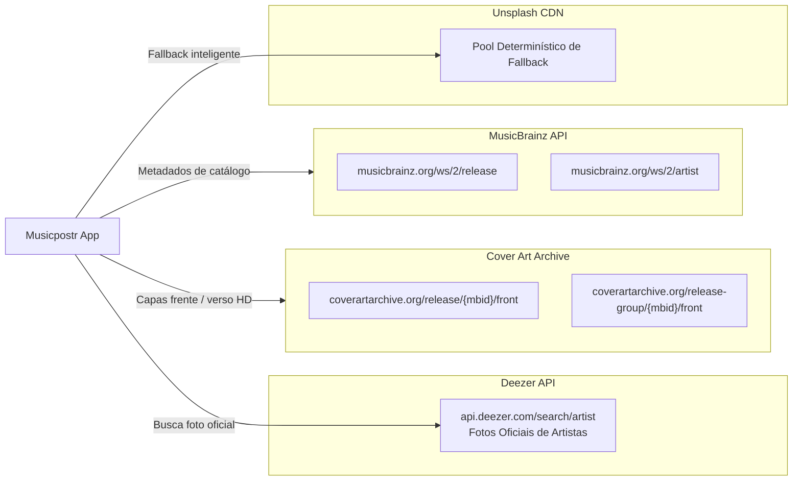

# 🌐 Serviços e APIs Externas — Musicpostr Mobile

Este documento descreve detalhadamente a camada de integração de dados localizada em `src/services/`, as APIs de terceiros consumidas e as políticas de cache.

---

## 📡 1. Provedores e APIs Consumidas

---

## 🔍 2. `artistImage.service.ts`

Responsável por resolver fotos oficiais de artistas através da API pública do Deezer.

- **Endpoint**: `https://api.deezer.com/search/artist?q={name}&limit=10`
- **Validação Estrita de Normalização**:
  - Remove acentos, pontuação e converte para minúsculas (`normalize(name)`).
  - Garante correspondência exata do nome antes de aceitar a imagem, evitando que artistas homônimos ou resultados aproximados exibam fotos erradas.
- **Cache Local & Debounce**:
  - Armazena as URLs mapeadas no `Storage` sob a chave `musicpostr_artist_images_v1`.
  - Agrupa gravações no disco através de um timer de debounce de 800ms para evitar I/O excessivo.
- **Prevenção de Requisições Concorrentes**:
  - Utiliza um mapa de promessas `inflight` para garantir que múltiplas chamadas simultâneas para o mesmo artista compartilhem a mesma requisição de rede.

---

## 🖼️ 3. `coverArt.service.ts`

Gerencia o acesso ao **Cover Art Archive** para download de capas de lançamentos musicais em alta definição.

- **Endpoints Suportados**:
  - `https://coverartarchive.org/release-group/{mbid}/front`
  - `https://coverartarchive.org/release/{mbid}/front`
  - `https://coverartarchive.org/release/{mbid}/back` (para inspecionar a parte traseira do encarte)
- **Seleção de Resolução Otimizada**:
  - Miniaturas para listas rápidas: `front-250.jpg`
  - Resolução média para cards: `front-500.jpg`
  - Tela cheia / Detalhes do álbum: `front-1200.jpg` ou imagem original
- **Negative Caching (Cache Negativo)**:
  - Se um álbum não possuir capa cadastrada no Cover Art Archive (status 404), o MBID é adicionado ao conjunto `missingCoversMemory` e persistido em `musicpostr_missing_covers_v2` com TTL de 24 horas, evitando requisições 404 repetitivas.
- **Pool de Fallbacks do Unsplash**:
  - Quando não há capa disponível no CAA, uma função de hash calcula um índice consistente para selecionar uma foto artística de alta resolução de um pool estático do Unsplash.

---

## 🎶 4. `musicBrainz.service.ts`

O núcleo da lógica de negócios e do catálogo musical do aplicativo (com mais de 3.600 linhas de código).

### Principais Funcionalidades

1. **Catálogo Integrado de Álbuns e Músicas**:
   - Milhares de álbuns e faixas pré-catalogados abrangendo dezenas de gêneros (*Rock, Pop, Indie, Jazz, Metal, Hip-Hop, MPB, Eletrônica*).
   - Suporte a busca em tempo real por termos livres (filtrando álbuns, artistas e faixas simultaneamente).
2. **Sistema de Avaliação & Reviews**:
   - `submitAlbumReview(albumId, rating, comment)`: Salva notas de 1 a 10 e comentários associados.
   - `getMyReviews()`: Retorna o histórico de avaliações do usuário atual.
   - `likeReview(reviewId)` / `unlikeReview(reviewId)`: Interações comunitárias com suporte a curtidas e contagem reativa.
   - `addReviewComment(reviewId, commentText)`: Fio de respostas e discussões em resenhas.
3. **Gerenciador de Listas do Usuário**:
   - `getUserLists()`: Retorna as listas existentes (incluindo a lista padrão pré-criada "Quero Ouvir").
   - `createUserList(title, description, isPublic)`: Permite criar coleções customizadas.
   - `addAlbumToList(listId, album)` / `removeAlbumFromList(listId, albumId)`: Gerencia itens dentro de cada lista.
4. **Artistas Seguidos (Ídolos)**:
   - `getFollowedArtistIds()`: IDs de artistas seguidos.
   - `toggleFollowArtist(artist)`: Alterna o status de seguir/deixar de seguir com emissão de evento reativo.
5. **Timeline / Feed da Comunidade**:
   - `getCommunityFeed()`: Retorna eventos recentes da rede social (novas avaliações, novos favoritos, listas criadas, novos ídolos).
   - `publishFeedActivity(activity)`: Emite uma nova atividade no feed com sincronização imediata.
6. **Perfil do Usuário**:
   - `getUserProfile()` / `updateUserProfile(partialProfile)`: Gerencia nome de exibição, username `@`, biografia, avatar e banner.
